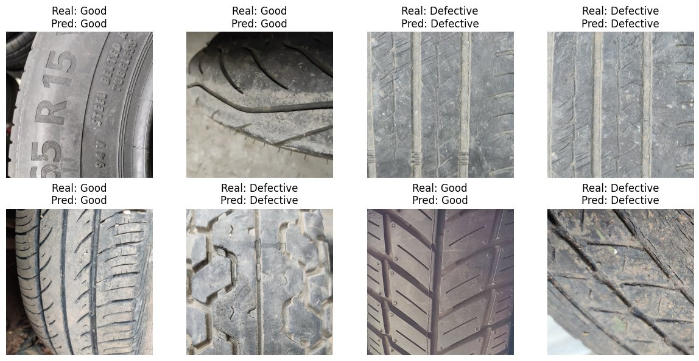
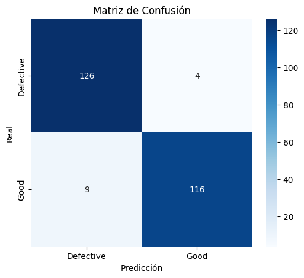
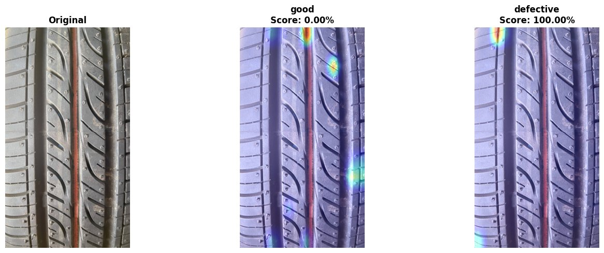

# PIC: detección de defectos en llantas

Tesis de grado de Ingeniería en Ciencias de la Computación (itinerario de Sistemas Inteligentes, Universidad Nacional de Loja, 2026). Clasificador de imágenes que separa llantas buenas de defectuosas con transfer learning sobre VGG16. La versión final llega a 94,9 % de exactitud en el conjunto de prueba, y Grad-CAM muestra qué zona de la llanta decide cada predicción.

## Versiones

| Notebook | Exactitud en prueba |
| --- | --- |
| `Version1.ipynb` | 90,6 % |
| `Version2.ipynb` | 91,4 % |
| `Version3.ipynb` | 94,9 % |
| `Version_3.ipynb` | 94,1 % (otra división, 340 imágenes de prueba) |

## Resultados

La versión 3 acierta 242 de 255 llantas de prueba: detecta 126 de las 130 defectuosas (96,9 %) y confunde 9 buenas con defectuosas.

Grad-CAM marca en qué zona de la llanta se apoya el modelo para cada clase:

## Cómo funciona

- **Datos**: 1 698 imágenes en dos clases (`Good` y `Defective`), divididas 70/15/15 de forma estratificada (1 188 de entrenamiento, 255 de validación y 255 de prueba).
- **Modelo**: VGG16 preentrenado en ImageNet con las últimas 8 capas descongeladas para fine-tuning, encima dos capas densas con regularización L2 y dropout.
- **Entrenamiento**: aumentación con volteo y rotación, Adam con tasa de 1e-5, early stopping y reducción de la tasa cuando la validación se estanca.
- **Explicabilidad**: `EvaluacionGradCam.ipynb` carga el mejor modelo y dibuja el mapa de calor Grad-CAM sobre la imagen.

## Stack

Python, TensorFlow/Keras, scikit-learn, OpenCV, Google Colab.

## Cómo correrlo

Los notebooks están pensados para Google Colab: montan Google Drive y leen el dataset desde `MyDrive/Tyre dataset` (una carpeta por clase).